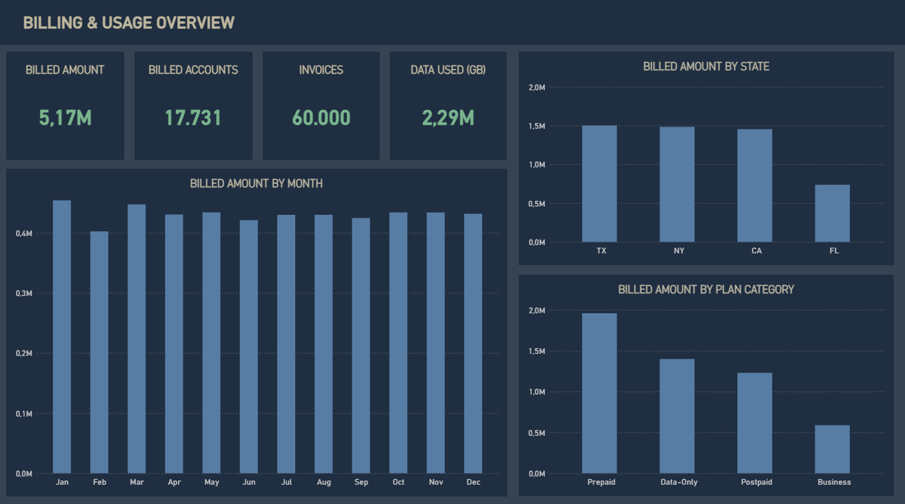

# Telecom Data Warehouse (SQL Server, Medallion Architecture)

A local SQL Server warehouse that turns six messy telecom CSVs from simulated BSS and OSS systems into a Gold dimensional model, with a Python runner for full refreshes and a Power BI overview report on top.

**Tools:** SQL Server · T-SQL · Python · Power BI

**Data:** 6 synthetic CSVs 

## Goal
Give analysts a single trusted model for billing, usage, and plan analysis instead of querying six raw files with conflicting formats.

## Architecture

Each layer has its own schema in the local `telco_dwh` database.

| Layer | What it does |
| --- | --- |
| Bronze | Loads the source CSVs into staging tables with `BULK INSERT`, preserving raw values. Each run truncates and reloads. |
| Silver | Trims text, standardizes customer keys and categorical values, converts dates and numbers, and handles missing or invalid values. All six tables refresh in one transaction. |
| Gold | Customer-account and service-plan dimensions plus a billing/usage fact view at one row per invoice, with business-friendly column names. Gold views read Silver directly. |

## Source data
Synthetic data split across two simulated source systems, with missing values, inconsistent formats, and conflicting attributes built in. The files live in `data/source_bss` and `data/source_oss`. These are simulated assignments, not extracts from real telecom systems.

| Source system | Data used |
| --- | --- |
| BSS (Business Support System) | Customer accounts and churn status, monthly usage and invoice charges, service plans with prices and allowances |
| OSS (Operations Support System) | Customer addresses, demographics, plan categories with credit-check requirements |

## Design decisions
- **Full truncate-and-reload in Bronze:**  repeatable runs, small data volume
- **One transaction for all six Silver tables:** a failed run never leaves Silver half-refreshed
- **Gold as views, not tables:** always current with Silver, no extra load step

## Data quality

Issues found and how they were handled:

- Inconsistent customer key formats (`CUS-` prefix and mixed case) → Trimmed, uppercased, and stored without the prefix. Values that do not match the expected format become `NULL`.
- Placeholder or malformed customer attributes → `N/A` last names and emails matching the specified invalid patterns become `NULL`; blank strings are also converted to `NULL`.
- Inconsistent date formats → Dates are parsed using the expected formats for each source column. Unparseable dates become `NULL`; contract end dates earlier than the join date are set to `NULL`.
- Inconsistent boolean values → Churn and credit-check values are mapped from recognized text values (`T`/`TRUE`, `F`/`FALSE`, `Y`/`YES`, `N`/`NO`) to bits. Other values become `NULL`.
- Inconsistent identifiers and labels → Invoice numbers, plan SKUs, and selected IDs are trimmed and uppercased. State names and country names are mapped to standard abbreviations where specified; other state and country values are trimmed and uppercased.
- Inconsistent demographic values → Gender labels are standardized to `Female` or `Male`; unrecognized values become `NULL`. Birth dates are parsed from the supported date formats.
- Numeric fields stored as text → Values are converted to their target numeric types with `TRY_CONVERT`; invalid or out-of-range values become `NULL`. A dollar sign is removed from `total_charge` before conversion.
- Missing values → Blank strings and specified placeholders are converted to `NULL`. The procedure does not impute missing values.

This procedure loads BSS and OSS tables separately. It does not reconcile conflicting customer attributes between those sources or apply a source-precedence rule; any such reconciliation would need to be handled in a later transformation.


## Power BI report
The [report](power_bi/overview_report.pbix) gives a one-page overview of billed amounts, accounts, invoices, and data usage, with monthly, state, and plan-category breakdowns. It shows that the Gold model supports reporting; the focus of the project is the engineering pipeline.



## How to run
**Prerequisites:** local SQL Server, Python 3, and `sqlcmd` on your PATH. The runner uses Windows authentication and the Python standard library. SQL Server needs permission to read the project's `data` folder.

1. **One-time setup.** Run these in order in SSMS or `sqlcmd`:
   - `scripts/init_db.sql`
   - `scripts/bronze/DDL_bronze.sql`
   - `scripts/silver/DDL_silver.sql`

   > ⚠️ Setup recreates the database and tables. Run it only to initialize or deliberately reset the warehouse.

2. **Set your server.** Change `SERVER` in `run_warehouse.py` (default `.\SQLEXPRESS`). The database name is `telco_dwh`.

3. **Run the pipeline** (also use this for every later full refresh):
```powershell
   python run_warehouse.py
```
   It deploys both procedures, loads Bronze then Silver, and creates or updates the Gold views. It stops if any SQL command fails.

4. **Open the report.** Open `power_bi/overview_report.pbix`, update the connection if needed, and refresh.

## Repo structure
```
├── data/
│   ├── source_bss/
│   └── source_oss/
├── scripts/          # init, bronze, silver, gold
├── power_bi/         # report and screenshot
└── run_warehouse.py
```

## Limitations and next steps
- Full reload on every run; no incremental loading
- Local setup only: Windows authentication and a hard-coded `SERVER` value
- Synthetic data, so no real-world edge cases such as late-arriving records
